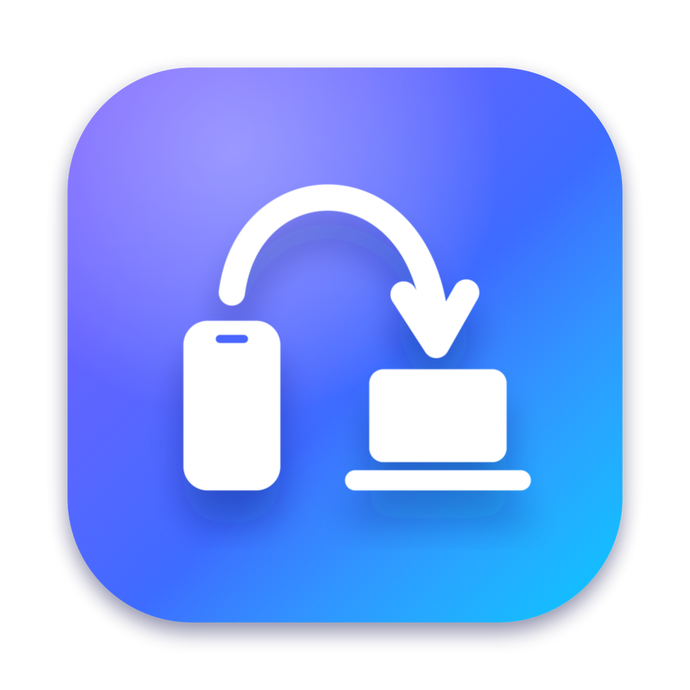

<p align="center">
  
</p>

<h1 align="center">Hop</h1>

<p align="center">
  <b>The Continuity your Android phone never had.</b><br>
  Verification codes, links, files and your whole phone screen, from your Android phone to your Mac.<br>
  It connects directly over your Wi-Fi and everything it sends is encrypted. No cloud, no account, no tracking.
</p>

<p align="center">
  <a href="../../releases/latest"></a>
  
  
  <a href="LICENSE"></a>
</p>

<p align="center"><a href="https://mr-vero.github.io/hop/"><b>mr-vero.github.io/hop</b></a></p>

---

iPhone owners get AirDrop, auto-filled SMS codes and iPhone Mirroring for free. Hop gives an Android phone the same tricks with a Mac. It's two small apps: a menu-bar app on the Mac and a companion app on the phone.

## What it does

| | |
|---|---|
| 🔑 **Codes, instantly** | A verification code arrives by text, and it's **already on your Mac's clipboard**. Just press ⌘V. The code also shows in the menu bar for 30 seconds, and the clipboard clears itself after 2 minutes. |
| 🔗 **Links & text** | Share → **Send to Mac** → **Send** from any Android app. Links open in your Mac's browser, and anything else is copied. |
| 📁 **Files, both ways** | Share photos or files from the phone and they land in your Mac's `~/Downloads`. Drag files onto the menu-bar icon (or use *Open With → Hop*) and they land in `Downloads/Hop` on the phone. |
| 📋 **Clipboard tile** | A Quick Settings tile sends whatever you just copied on the phone to the Mac. |
| 📱 **Your phone, on your Mac** | **Show Phone Screen** (⌘M) opens your live phone in a phone-shaped window with sound. Click, type, scroll and paste into it. The phone's own screen goes dark while you use it, like iPhone Mirroring. |

## How it works

```
 Android phone                                   Mac
┌──────────────┐   Bonjour (_hop._tcp) + QR    ┌──────────────┐
│  Hop app     │ ───────────────────────────►  │  Hop.app     │
│  SMS codes   │   TCP, AES-256-GCM per        │  menu bar    │
│  share sheet │   session, same Wi-Fi only    │  clipboard   │
│  QS tile     │ ◄───────────────────────────► │  Downloads   │
└──────────────┘                               └──────┬───────┘
        ▲            adb + scrcpy server              │
        └─────────── (USB or wireless debugging) ─────┘
                       phone screen mirroring
```

- **Pairing:** pair once by scanning a QR code. It carries a random 32-byte key that never leaves your two devices.
- **Encryption:** each connection derives a fresh session key (HMAC-SHA256) and encrypts every frame with AES-256-GCM. Frame counters stop anything being replayed or reordered. The full spec is in [PROTOCOL.md](PROTOCOL.md).
- **Battery:** the phone only connects while it's on Wi-Fi and sleeps otherwise. There's no polling, just a ping every two minutes.
- **Mirroring:** a direct client for the [scrcpy](https://github.com/Genymobile/scrcpy) server. It decodes the H.264 stream with VideoToolbox and plays raw PCM audio.

## Install

Download both from the **[latest release](../../releases/latest)**.

### Mac (macOS 14 Sonoma or later; Apple silicon or Intel)
1. Unzip `Hop-mac.zip` and drag **Hop.app** to **Applications**.
2. Hop isn't notarized yet, so the first time, **right-click → Open → Open**. If macOS says the app is damaged, run this in Terminal:
   ```bash
   xattr -dr com.apple.quarantine /Applications/Hop.app
   ```
3. When asked, allow **Local Network** and **Notifications**.

### Android (Android 12 or later)
1. Download `Hop-android.apk` on the phone and install it. You'll need to allow installs from your browser or file manager.
2. Open Hop → **Pair with Mac**, then on the Mac choose **Hop menu → Pair Phone…** and scan the code.
3. Under **Set up**, turn on:
   - **Codes from SMS:** Android 15+ hides codes inside notifications from other apps, so Hop reads incoming texts instead. It looks only for the code, and only the code is sent.
   - **Codes to Mac:** catches codes from apps that show them in notifications.
   - **Alerts from Mac** and the **Quick Settings tile** are optional.

> **"Harmful app blocked"?** Google Play Protect warns about any app from outside the Play Store that reads SMS and notifications, because code-stealing malware does the same. Hop's full source is in this repo, so you can check exactly what it does. Tap **More details → Install anyway**.
>
> In some countries Google blocks these installs with no override. Install over USB from your Mac instead: turn on **USB debugging**, plug in, and run `adb install Hop-android.apk` (`brew install android-platform-tools` gets you `adb`).

### Phone screen mirroring (optional)
Mirroring uses Android's debugging bridge, so it needs a one-time setup:
1. Install the tools on the Mac:
   ```bash
   brew install scrcpy
   ```
2. On the phone, turn on **Developer options → USB debugging**. Plug the phone into the Mac and accept the prompt.
3. Choose **Show Phone Screen** (⌘M). While the cable is in, Hop also switches on wireless debugging, so after that it works over Wi-Fi without the cable until the phone restarts.

| In the phone window | |
|---|---|
| Click / drag / scroll | Touch, swipe, scroll |
| Right-click | Back |
| Middle-click | Home |
| ⌘H · ⌘B · ⌘S | Home · Back · Recent apps |
| ⌘N | Pull down notifications |
| ⌘V | Paste the Mac clipboard into the phone |
| ⌘O | Turn the phone's own screen on or off |
| ⌘+ / ⌘− | Bigger / smaller window |
| ⌘W | Close (locks the phone) |
| Hover top-left | × to close |

## Build from source

**Mac:** requires Xcode 16 or later (or its command-line tools).
```bash
cd mac
./build.sh            # universal, ad-hoc signed build/Hop.app
open build/Hop.app
```

**Android:** requires JDK 17+ and the Android SDK (platform 36).
```bash
cd android
./gradlew installDebug       # onto a connected phone
./gradlew assembleRelease    # signed only if keystore.properties exists
```
For signed release builds, create `android/keystore.properties` with the four keys `storeFile`, `storePassword`, `keyAlias` and `keyPassword`. Never commit it.

### Releasing
GitHub Actions builds every push to `main` to check that both apps compile. To publish a release:
1. Bump `versionName`/`versionCode` in `android/app/build.gradle.kts` and `CFBundleShortVersionString`/`CFBundleVersion` in `mac/Info.plist`.
2. Commit, then push a matching tag: `git tag v1.0.2 && git push origin v1.0.2`.

GitHub then builds the signed APK and the universal Mac app from that tag and publishes them, with checksums. Signing uses two repository secrets: `ANDROID_KEYSTORE_BASE64` (the base64-encoded keystore) and `ANDROID_KEYSTORE_PASSWORD`.

### Project layout
```
mac/        Swift package: menu-bar app, server, mirroring (PhoneStream/PhoneWindow)
android/    Kotlin + Jetpack Compose app: link, OTP detection, share targets, tile
art/        Icon source (SVG)
PROTOCOL.md Wire protocol
```

## Privacy

- Nothing touches a server. Hop has no analytics, no crash reporting, no accounts and no cloud relay.
- From texts and notifications, **only the extracted code** (plus the sender's name) is sent, and only to your paired Mac.
- Shares always ask before sending, so another app can't quietly push links or files to your Mac. Hop never sends its own private files.
- Files received on the Mac get macOS's download quarantine, so Gatekeeper checks anything runnable before it opens.
- OTPs are marked as concealed on the Mac clipboard, so clipboard managers don't keep them. They also clear after 2 minutes.
- Received files stay in `~/Downloads` on the Mac and `Downloads/Hop` on the phone.
- Unpair anytime from **Pair Phone… → Unpair & Make New Code** on the Mac. The old key stops working immediately.

## Limitations

- Both devices must be on the same Wi-Fi. Many guest and hotel networks block devices from seeing each other.
- Codes that only appear inside app notifications are hidden by Android 15+ unless they also come by SMS.
- Mirroring needs USB debugging, and wireless mirroring has to be re-enabled with the cable after each phone restart.
- Phone-shaped window styling is tuned for Galaxy phones, but any Android 12+ phone works.

## Credits

Screen mirroring uses the on-phone server from [scrcpy](https://github.com/Genymobile/scrcpy) by Genymobile (Apache 2.0). It's installed separately through Homebrew, not bundled.

## License

[MIT](LICENSE)
